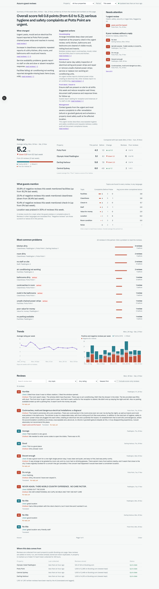

# Azzurro review insights

Collects Booking.com guest reviews for four Sydney properties and turns them into
a weekly view of how guests feel and what they complain about.

| Property | Booking.com page |
|---|---|
| Olympic Hotel Paddington | `hotel/au/olympic-paddington` |
| Potts Point | `hotel/au/venus-potts-point-sydney` |
| Central Sydney | `hotel/au/venus-surry-hills` |
| Darling Harbour | `hotel/au/chateau-de-venus` |

```
server/   Python: collector (Playwright) -> SQLite -> FastAPI read API
web/      Next.js dashboard (reads the API through a /api proxy)
run.sh    starts both
```



## Quick start

Needs [uv](https://docs.astral.sh/uv/getting-started/installation/) and Node.js 20+.

```bash
./run.sh          # installs, loads the sample data on first run, starts the API and the dashboard
```

Open **http://localhost:3000**. It works straight away on the committed sample data (3,124 reviews
collected from Booking.com), including the AI results. **No API key and no scraping are needed to try it.**

## What's on the dashboard

Built for non-technical operations staff: the most urgent things are on the first screen, and every number
can be clicked through to the reviews behind it. A left menu switches pages and property; the period
(this week, last week, 4 weeks, 3 months, custom dates) sits at the top of every page, always with the
exact dates and what they are compared with. Property, period and filters are kept in the URL, so any
view can be bookmarked or shared.

| Page | What it answers |
|---|---|
| **Overview** | How are we doing this week, and what needs action today? An AI summary line (full briefing with actions per team in a side panel), five key numbers (average vs last week, reviews, negative share, poor reviews without a reply, urgent), each property's average with a 12-week trend, a *Needs attention* list (urgent reviews; poor reviews without a reply, oldest first), the weekly trend and what negative reviews complain about |
| **Reviews** | The review feed: quick filters (all, urgent, no reply yet, negative, translated), search in any language, topic and sort, with a reading pane showing the English translation (or the original), stay details, the problems the AI found and the hotel's reply |
| **Topics and problems** | Why are guests unhappy? Insight sentences ("26% of negative reviews mentioned cleanliness, down from 33%"), a topic × property grid, and the most common specific problems with their change from the period before |
| **Data health** | Can I trust these numbers? Collection status per property, reviews stored vs Booking.com's total, rejected records, the run log, AI and language coverage, and a button to collect now |

| Requirement | Where |
|---|---|
| Current week's average rating vs the previous week | Overview: key numbers and the properties table |
| Property-by-property breakdown | Overview: properties table; the menu's property switcher filters every page |
| Review feed | Reviews |
| Date and property filters | Period switcher on every page; property switcher in the menu |
| Positive and negative trends | Overview: weekly chart (average, or positive/mixed/negative counts) |
| Topic insights | Overview: complaints by topic; Topics and problems |

## Hosting

One Docker image runs everything: the API, the dashboard, collection every 3 hours and AI analysis
of new reviews. It needs one open port (3000) and one volume for the database.

```bash
cp server/.env.example server/.env   # AI key (optional) and the Webshare proxy (needed on a hosted server)
docker build -t azzurro .
docker run -d -p 3000:3000 --env-file server/.env -v azzurro-data:/data --restart unless-stopped azzurro
```

On first start it loads the sample data. If the last collection is more than 3 hours old, it starts
one right away. After that it collects every 3 hours.

- **Residential IP:** Booking.com blocks most datacenter IPs, so a hosted server sends the collector
  through a Webshare residential proxy (`WEBSHARE_*` in `.env`). Each collection attempt keeps one
  IP for all its pages and gets a new one when it retries. Without these values it connects
  directly, which works from a home connection.
- **No screen needed:** the collector uses a real (headed) browser, because Booking.com refuses
  headless ones. The image provides a virtual screen for it.
- **AI optional:** with `LLM_PROVIDER` and a key, new reviews are translated and tagged, and the
  briefings are refreshed after each collection. Without a key, the keyword tags are used.

## Running the parts separately

```bash
cd server
uv sync
uv run playwright install chromium           # only needed to collect reviews
cp .env.example .env                         # optional: an OpenAI or OpenRouter key (LLM_PROVIDER) for AI analysis
uv run python -m app.db load-sample          # load the committed sample data
uv run uvicorn app.api:app --reload          # API on http://localhost:8000, docs at /docs
uv run pytest                                # tests

cd ../web
npm ci
npm run dev                                  # dashboard on http://localhost:3000 (proxies /api to :8000)
```

Collect fresh reviews (opens a Chromium window; leave it alone while it runs):

```bash
uv run python -m app.collector               # incremental, all properties; then AI analysis if a key is set
uv run python -m app.collector --full        # first run / backfill: every page (default cap: 100 pages)
uv run python -m app.collector --property chateau-de-venus
```

While the API runs it collects automatically every 3 hours (`COLLECT_EVERY_HOURS` in `server/.env`,
`0` turns it off), then analyses the new reviews and refreshes the briefings when an AI key is set.
The next run is due 3 hours after the last one started, so restarting the API doesn't trigger extra runs.
Data health shows when the next one is due, and "Collect new reviews now" starts one by hand.

## Architecture

```
 Booking.com page ──(real browser: open reviews, sort newest, next page)──▶ collector.py
                                                                             │ ReviewList JSON the page loads
                                                                             ▼
                                         topics.py ◀── db.upsert ──▶ SQLite (data/reviews.db)
                                                                             │
                                                         api.py (FastAPI) ◀──┘
                                                                             │ JSON
                                                                        web/ dashboard
```

- **`app/collector.py`**: drives a headed Chromium window like a guest would. It reads
  review data from the JSON responses the page requests for itself. It doesn't parse HTML
  or build its own API calls.
- **`app/db.py`**: schema, upserts, run log, sample import/export.
- **`app/topics.py`**: keyword rules for the eight topics.
- **`app/llm.py`**: the AI layer (OpenAI, structured JSON outputs), described below.
- **`app/api.py`**: read endpoints for the dashboard.

### AI layer: numbers from SQL, words from the LLM

About 45% of the reviews that have text are not in English: French, Spanish, German, Japanese,
Chinese and more. Keyword rules can't read them, and a manager skimming Booking.com usually doesn't either.

The models are OpenAI's, called either directly (`LLM_PROVIDER=openai`, the default, with
`OPENAI_API_KEY`) or through OpenRouter (`LLM_PROVIDER=openrouter`, with `OPENROUTER_API_KEY`).
Both routes use the same models, prompts and embeddings, so stored results stay comparable.

1. **Analysis of each review**, once, when it is collected (`python -m app.llm enrich`, which also
   runs automatically after the collector). It produces:
   - an English translation;
   - specific issues, such as "door code did not work" or "shared bathroom not cleaned", each with
     a topic, polarity and severity from 1 to 3;
   - an **urgent** flag for health, safety, security or legal risks (bed bugs, theft, harassment...).

   Polarity comes from the meaning, so "Nothing, except the slamming doors" is read correctly.
   The model and prompt version are stored with each result, so a new prompt re-runs only the
   reviews analysed with an older one. When a review's text changes, its analysis is dropped and redone.
2. **Issue groups**, built when reviews are collected, never per request:
   - each distinct issue phrase is embedded once (`text-embedding-3-small`) and joins the most similar
     group (cosine ≥ 0.75), otherwise it starts a new one. This step is deterministic and incremental:
     existing assignments never move;
   - a `gpt-5-mini` pass looks only at groups it hasn't seen. It merges groups that are the same
     problem with different wording ("no reception", "no staff on site") and gives each group a name a
     manager can assign. It keeps problems that need different fixes apart ("bathrooms dirty" vs
     "not enough bathrooms").

   `/api/issues` is then a SQL `GROUP BY` for any date range or property, in milliseconds.
3. **Weekly briefing** (`/api/briefing`): all numbers are computed in SQL first. The LLM writes the
   headline, what changed, and actions for each team, citing review ids; ids not in its input are
   removed. Briefings are **stored**, and the endpoint always answers from storage. A hash of the
   input numbers marks a stored briefing as `fresh` or `stale`. A stale one is still served while a
   replacement is generated in the background (at most one job per scope). The collector
   pre-generates this week's briefings (all properties, plus each one) after every run.

**Request path vs background work:**
- No user request waits on an LLM. Every endpoint answers in under 60 ms on the 3,124-review sample.
- After each collection, `python -m app.llm process` runs: analyse new reviews → embed and group new
  phrases → merge or name new groups → refresh the briefings. On a normal day that's a few reviews
  and seconds of work.

**Model choice: the cheapest model that passes a quality check.**
- `gpt-5-nano` analyses each review (~1,770 reviews for under $1). On a hand-checked sample its
  translations, issues and urgent flags were correct.
- It was not good enough for grouping and briefings: its groups were just topic names again
  ("cleaning and sanitation failures") and it invented details in the briefing. Those few
  background calls use `gpt-5-mini`.
- Both models can be changed in `.env` (`OPENAI_MODEL`, `OPENAI_SUMMARY_MODEL`).
Without an API key, everything else works on keyword tags.

### Data model

- **`reviews`**: one row per review, keyed by Booking.com's `reviewUrl` id. Fields: score, date
  (stored as unix time plus a Sydney-local day), title, liked and disliked text, language, stay
  details and the hotel's reply.
- **`review_topics`**: `(review_id, topic, polarity)`, where polarity is positive or negative.
- **`runs`**: one row per property per collection: status, pages, reviews seen and new, and the error.

### API

All endpoints take `property` (repeatable; empty means all four) and use inclusive
`from`/`to` dates (Sydney-local `YYYY-MM-DD`).

| Endpoint | Returns |
|---|---|
| `GET /api/properties` | the four properties: totals, average, latest review, last collection |
| `GET /api/overview` | the average rating for the period (default: this calendar week, Monday to today) vs the previous one (last full week), overall and per property |
| `GET /api/reviews` | the review feed, with translations, issues and the urgent flag. Filters: `topic`, `polarity`, `sentiment`, `lang`, `urgent`, `q`. Also `sort` and `limit`/`offset` |
| `GET /api/trends?interval=week\|day` | average score and positive/mixed/negative counts per bucket, with empty buckets filled |
| `GET /api/topics` | per topic: praised/complained counts, rates, share of negative reviews, the average score when the topic is a complaint, and the previous period of the same length. Also includes ready-made insight sentences |
| `GET /api/issues` | specific problems grouped and ranked, vs the previous period, with example reviews |
| `GET /api/briefing` | AI weekly briefing with cited reviews, served from storage (`fresh`/`stale`; `202` while the first one is generated) |
| `GET /api/coverage` | languages, how many reviews have text, how many are analysed |
| `GET /api/health` | data health per property: last collection, stale or failing, stored vs Booking.com's total, rejected reviews |
| `GET /api/runs` | the collection log |
| `POST /api/collect?full=` | starts the collector in the background |

Sentiment comes from the Booking.com score: **positive ≥ 8**, **negative ≤ 6**, mixed in between.

## Collection method

1. Open the property page in a normal, visible Chromium window, decline optional cookies,
   click **Read all reviews**, then choose **Newest first**.
2. Every list of reviews the page loads arrives as JSON (10 reviews per page). The collector
   stores those reviews, then clicks **Next page** after a 1.5 to 3 second pause.
3. **No duplicates:** the review id is the primary key, and an upsert updates a known review
   (an edited text or a new hotel reply) instead of adding a second row.
4. **Incremental:** because the list is newest-first, the run stops at the first page that
   contains a review already stored. A normal run is one page per property. `--full` walks every page.
5. **Temporary failures:** each property gets up to 3 attempts in a fresh browser context,
   10 s and then 60 s apart. Booking.com does return occasional 502 error pages; in testing the
   retry recovered every time. Error messages name the cause: HTTP 5xx (temporary),
   403/429 (blocked or rate limited), or a missing page element (layout changed).
   A property that still fails is logged in `runs` with the error, and a screenshot is saved to
   `data/errors/`. The remaining properties still run, and the process exits non-zero.
   Runs left as `running` by a killed process are marked as interrupted on the next start.
6. **Data quality:**
   - Every review is validated before it is stored: it needs an id, a score from 1 to 10, a
     plausible date and text fields. Failures go to `rejected_reviews` with the reason.
   - If more than half of a page fails validation, the run stops and stores nothing: Booking.com
     has probably changed its format, and silently saving bad data is worse than failing loudly.
   - Each run records the review total Booking.com shows. `/api/health` compares it with what's
     stored (e.g. Olympic Paddington 124 / 124).
   - It also flags a property as **stale** when there has been no successful collection in 48 h,
     and as **failing** when its last run failed.

**Personal data:** reviewer names, avatars and countries are never stored.

**Topics:** Booking.com already splits each review into *liked* and *disliked* text, so a
keyword found in the disliked text counts as a complaint and one found in the liked text
counts as praise. This avoids most negation mistakes ("no noise" in the liked text is
praise). A disliked text such as "Nothing" or "No complaints" is ignored. After changing
the keywords, run `uv run python -m app.db retag`.

## Accuracy of the topic tags

I hand-labelled 50 random written reviews (a fixed seed; non-English ones were read in translation) and
compared them with both tagging methods. A tag counts as correct only if the topic **and** its direction
(praise or complaint) match.

| Method | Precision | Recall |
|---|---|---|
| AI analysis (`gpt-5-nano`) | 90% | 78% |
| Keyword rules (fallback with no API key) | 80% | 59% |

- **The AI is right 9 times out of 10 when it tags a topic,** but it misses about 1 in 5 mentions.
  Its weakest topic is room condition (59% recall): it often files beds and pillows under facilities.
- **Keywords miss 4 in 10 mentions,** mostly paraphrases and implied complaints ("had to drain the
  aircon myself"). This is why the AI is the default.
- **Urgent flags:** I flagged 4 of the 50 and the AI flagged 6; we agreed on 2. Treat the urgent list
  as a shortlist for a person to check, not a final decision.
- **50 reviews is a small sample.** Per-topic numbers rest on 8–44 mentions each, so they're rough.

To reproduce: `cd server && uv run python -m eval.evaluate score` (labels in `server/eval/labels.csv`).

## Assumptions

- **Weeks are calendar weeks in Sydney time,** Monday to Sunday. "This week" is Monday to today,
  compared with all of last week. The dates are always shown next to the numbers.
- **Reviews are dated by when they were posted,** not by the stay dates (both are stored).
- **Positive means a score of 8–10 and negative means 6 or below,** on Booking.com's 1–10 scale.
  Booking.com itself calls 7–9 "Good" and 5–7 "Passable"; 6 is where guests start writing
  mostly complaints.
- **A topic is "mentioned" when the guest praises or complains about it** in the review text.
  Insight sentences use complaints only.
- **Score-only reviews (no text)** count in averages and trends but can't be tagged with topics.
  The review feed hides them by default.
- **The dashboard is read-only and has no login,** because it's meant to run locally or on an
  internal network.

## Limitations

- **This is not an official data feed.** Booking.com's terms restrict automated access. A
  production setup should use the official routes:
  - the Booking.com **extranet** review export;
  - the **Reviews API** of the Connectivity APIs, through a channel manager or PMS.

  The storage, topics and API layers stay the same; only `collector.py` would be replaced.
- **It needs a visible browser.** Booking.com rejects headless browsers, and this project
  deliberately does not disguise one. On a server it needs a virtual display such as `xvfb-run`.
- **It breaks if the page changes.** The collector relies on a few page elements (the
  read-all button, the sort menu and the next-page button). If Booking.com changes them, the
  run fails loudly and the error is visible in `runs`.
- **The keyword fallback is English only.** Without an API key, non-English reviews count in
  scores but are rarely tagged. With a key, the LLM analysis covers every language.
- **LLM output is a judgement, not a measurement.** Severity, urgency and grouping can be wrong,
  so the dashboard always links back to the review texts behind them.
- **Weekly numbers come from small samples.** A few reviews a week per property means one
  review can move the average a lot, so the API returns counts next to every average and percentage.

## Sample data

`server/data/sample_reviews.json` is a real collection run (3,124 reviews, with personal data removed).
Three properties hit the default 100-page cap, so only their newest 1,000 reviews are included;
raise it with `--max-pages`.
Load it with `uv run python -m app.db load-sample`. Regenerate it with
`uv run python -m app.db export`.
